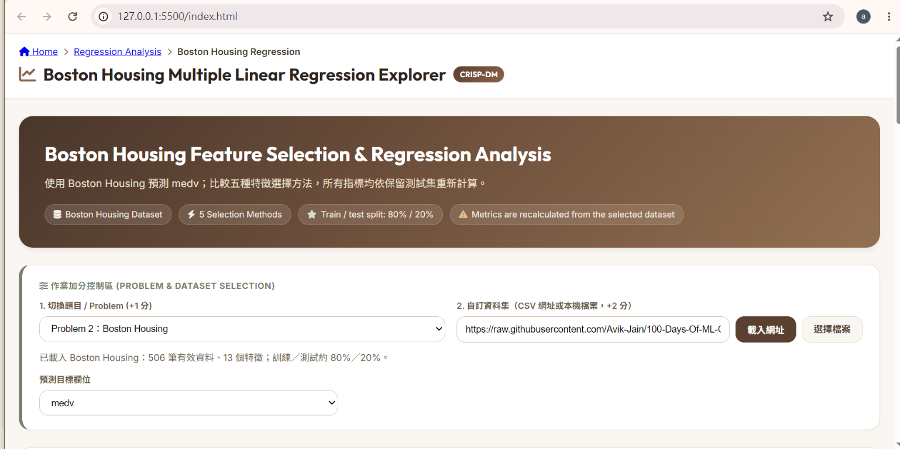

# 多元線性迴歸分析器

以瀏覽器操作的互動式迴歸分析網頁，使用奶茶大地色介面呈現 50 Startups、Boston Housing 與自訂 CSV 資料集。無須安裝 Flask 或啟動後端，開啟 `index.html` 即可使用。

## GitHub 專案

- 儲存庫：[https://github.com/susuannie/1014](https://github.com/susuannie/1014)
- Live Demo：[https://susuannie.github.io/1014/](https://susuannie.github.io/1014/)

## 畫面預覽

## 功能

- **兩個作業主題：**以題目下拉選單切換 50 Startups（預測 `Profit`）與 Boston Housing（預測 `medv`）。
- **自訂資料集：**輸入可公開讀取的 CSV 網址，或選擇本機 CSV；載入後可選擇數值型預測目標。
- **五種特徵選擇方法：**Lasso、Forward SFS、RFE、ElasticNet 與 Exhaustive Search；Compare All 可同時比較各方法的測試集 RMSE、R²。
- **模型分析：**切換特徵數 k，查看 RMSE、R²、Adjusted R²、MAE、F 統計量、迴歸公式與係數統計。
- **係數推論：**顯示標準誤、t 統計量、p 值、95% 信賴區間與 VIF，並標示顯著性與 VIF 風險。
- **互動預測：**數值特徵可透過數字輸入或滑桿調整；類別特徵以選單選擇。
- **殘差診斷：**列出測試集絕對殘差最大的最多 10 筆資料。

## 如何使用

1. 將 `index.html`、`app.js`、`styles.css` 放在同一個資料夾。
2. 使用瀏覽器開啟 `index.html`。也可以在 VS Code 使用 Live Server。
3. 在「切換題目」選擇 50 Startups 或 Boston Housing；若要分析其他資料，貼上 CSV 網址或選取本機檔案。
4. 自訂資料載入後，在「預測目標欄位」選擇要預測的數值欄位。
5. 切換特徵選擇方法及 k 值，查看模型指標、圖表、係數及預測結果。

## 自訂 CSV 格式

- 第一列須為欄位名稱，至少包含兩欄及 8 筆資料。
- 預測目標必須是數值欄位；其他數值欄位及符合條件的類別欄位會作為候選特徵。
- 網址匯入需要來源網站允許 CORS 跨來源存取；若網址無法匯入，可下載 CSV 後使用本機檔案選擇器。

## 計算方式與注意事項

- 資料以固定亂數切分為約 80% 訓練集與 20% 測試集；50 Startups 使用課程參考切分。
- 候選特徵依訓練集與目標的相關程度排序，最多取前 12 個；模型最多使用 5 個特徵。Exhaustive Search 依測試集 RMSE 比較子集。
- Compare All 會在圖表上顯示五種方法；同一時間的指標卡、公式、係數表與預測器以 Lasso 顯示。
- 迴歸與統計推論由瀏覽器端 JavaScript 計算，並非呼叫老師的 Flask／Python 後端；由於套件實作與參數可能不同，部分數值會與老師網站有差異。
- 係數的標準誤、p 值及信賴區間以所選特徵的 OLS 模型估算，未調整特徵選擇造成的推論偏差。VIF < 5 顯示為 Safe；殘差診斷以訓練集殘差標準差的兩倍作為檢視提示門檻。

## 專案檔案

- `index.html`：頁面結構與控制項。
- `styles.css`：奶茶大地色主題與版面樣式。
- `app.js`：資料匯入、模型計算、圖表、係數分析與預測功能。
- `preview.png`：README 畫面預覽。

頁面使用 Chart.js、PapaParse、Font Awesome 與 Google Fonts CDN，及公開資料集網址；初次載入和網址資料匯入需要網路連線。本機 CSV 內容在瀏覽器中處理。
